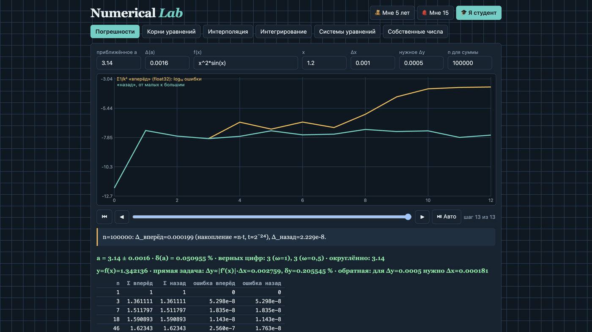

# Numerical Lab

**[Live demo → simakogan.github.io/numerical-lab](https://simakogan.github.io/numerical-lab/)**

An interactive numerical methods lab that runs entirely in the browser. Type a function or a matrix, pick a method, and step through it: the app draws the graph, animates every iteration and explains what is happening.



## Explanations on three levels

A switch in the top-right corner changes every explanation and every step caption:

| Level | Style |
|-------|-------|
| 🧸 Age 5 | everyday analogies, no formulas |
| 🎒 Age 15 | the idea of the method in plain words |
| 🎓 Student | formulas, error estimates, convergence conditions |

## Topics and methods

| Tab | Methods |
|-----|---------|
| Errors | absolute and relative error, correct digits, direct and inverse error problem, float32 summation order demo |
| Root finding | bisection, chords, Newton, combined chords and tangents, fixed-point iteration (cobweb plot), Lobachevsky (Graeffe) |
| Interpolation | Lagrange, Newton divided differences, Aitken scheme, Gauss forward/backward, Stirling, Bessel (click the plot to add points) |
| Integration | rectangles, trapezoids, Simpson, Newton 3/8, Chebyshev, Gauss; Runge error estimate |
| Linear systems | Gauss elimination with pivoting, Jacobi, Seidel, orthogonalization, steepest descent; convergence chart |
| Eigenvalues | power method, Leverrier, Krylov; roots on the complex plane |

Each method has a step player: back, forward, slider and autoplay.

## Run locally

No dependencies and no build step:

```bash
git clone https://github.com/SimaKogan/numerical-lab.git
cd numerical-lab
open index.html   # or just double-click the file
```

## Project structure

```
index.html        the whole app: markup, styles and code in one file
docs/             README screenshot
```

Function input accepts `x`, `+ - * / ^`, `sin cos tan atan exp sqrt abs ln lg pi e`, for example `x^4-x^3-2*x^2+3*x-3`. The interface is in Russian.

## Background

The set of topics follows a university numerical methods practicum (Donetsk State University, 1990). The code and the explanations are original.

## License

[MIT](LICENSE)
